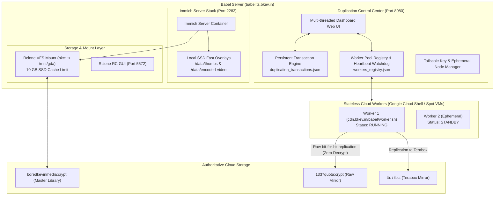

# Babel Immich & Duplication Control Center

A fault-tolerant, hybrid-cached storage and cloud-to-cloud duplication manager for Immich.

---

## 🏗️ Architecture Overview



---

## 📁 Repository Structure

```text
├── .gitignore                     # Strict secret boundary (blocks *.conf, *.env, DBs)
├── README.md                      # Architecture and operational guide
├── dashboard/
│   └── server.py                  # Real-time SSE dashboard, APIs, & transaction manager
├── worker/
│   └── worker.sh                  # Stateless, zero-credential runner for Cloud Shell / VMs
├── docker/
│   ├── docker-compose.yml         # Immich compose with hybrid SSD overlays
│   └── .env.example               # Sanitized environment variable template
├── systemd/
│   ├── immich-cache-dashboard.service # Dashboard systemd service definition
│   └── rclone-gda.service         # Authoritative Rclone VFS mount systemd service
└── scripts/
    ├── install.sh                 # One-step symlink installer for Debian
    └── update.sh                  # Safe git pull & zero-downtime service reloader
```

---

## 🚀 Key Features

1. **Hybrid SSD/Cloud Caching**:
   * Master library files stay in encrypted cloud storage (`bkc:`).
   * Fast thumbnails, profiles, and video previews are pinned to local SSD (`/data/thumbs`, `/data/encoded-video`) to eliminate latency.
   * VFS cache bounded at **10 GB** maximum on root SSD partition.

2. **Centralized Duplication Transaction Manager**:
   * All replication jobs are persistent transactions stored centrally on Babel (`duplication_transactions.json`).
   * Decoupled from compute workers: if a worker dies mid-transfer, another worker can resume the transaction with 1 click.
   * Monotonically increasing `lease_id` fencing prevents split-brain duplicate uploads.

3. **Stateless Compute Workers**:
   * Runners (`worker.sh`) contain **zero embedded credentials**.
   * On startup, runners fetch config into volatile `/dev/shm` RAM-disk, connect to Babel over Tailscale, and stand by for assignments.
   * Wiped cleanly upon process exit.

4. **Raw Bit-for-Bit Cloud Replication**:
   * Supports raw encrypted blob transfer between Google Drives (`boredkevinmedia:crypt ➔ 1337quota:crypt`) bypassing decryption and re-encryption.
   * MD5 hashes and modification timestamps match 100% across drives.

---

## 🛠️ Installation on Babel

1. Clone your private repository on Babel:
   ```bash
   git clone <YOUR_GITHUB_REPO_URL> /opt/babel-storage-control
   cd /opt/babel-storage-control
   ```

2. Run the installer:
   ```bash
   sudo ./scripts/install.sh
   ```

3. To safely pull updates in the future without interrupting Immich or transfers:
   ```bash
   sudo ./scripts/update.sh
   ```

---

## 🌐 Endpoints & Ports

| Port | Service | Description |
| :--- | :--- | :--- |
| `8080` | **Control Center** | Duplication manager, media cache browser, worker pool |
| `2283` | **Immich Web UI** | Photo/video library UI & mobile app endpoint |
| `5572` | **Rclone Web GUI** | Live VFS mount statistics and stream monitor |
