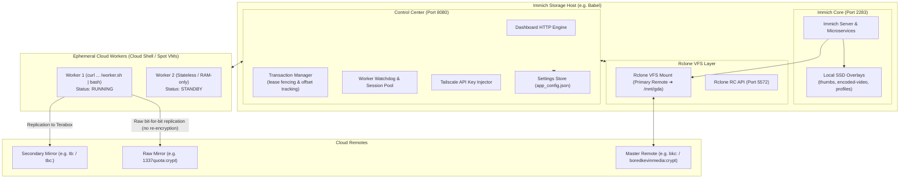

# Immich Duplication Control Center (Immiclone)

A lightweight, fault-tolerant duplication manager and hybrid cache dashboard built for Immich and Rclone.

I built this because I wanted an authoritative master library on cloud storage while replicating media across multiple backup remotes (like raw encrypted Google Drive mirrors, Terabox, or S3) without bogging down my local machine or paying for continuous dedicated cloud VMs. 

Instead of running long transfers directly on the storage server, **Immiclone decouples stateful transaction management from stateless compute workers**. The central server manages tasks and tracks live telemetry, while ephemeral runners (like Google Cloud Shell or spot VMs) do the heavy lifting using free gigabit datacenter pipes.

---

## Architecture Overview



---

## How It Works

### 1. Persistent Duplication Transactions
Transfers aren't just one-off bash scripts; they are managed as persistent transactions (`duplication_transactions.json`). 
- If a runner gets preempted or Cloud Shell times out, the transfer is marked `INTERRUPTED` with an exact byte offset snapshot.
- When you launch a new worker, you can resume the transaction with 1 click. Thanks to `--size-only` and offset math, existing files are verified instantly without re-uploading gigabytes.
- Monotonically increasing `lease_id` fencing prevents split-brain uploads if an old worker suddenly reconnects.

### 2. Stateless, Zero-Credential Workers
Runners don't have any permanent configuration or credentials:
- When a worker starts, it registers with the dashboard and stands by.
- When a transaction is assigned, the worker pulls `rclone.conf` directly into `/dev/shm` (Linux kernel RAM disk).
- Once the transfer completes or the worker is stopped, the RAM disk is wiped immediately.

### 3. Userspace Tailscale Tunneling
If your control server runs on a private Tailscale tailnet, you don't need root `/dev/net/tun` permissions on the worker machine:
- The dashboard automatically generates an ephemeral Tailscale auth key and bakes it into a 1-liner command.
- The worker boots `tailscaled` in unprivileged userspace networking mode with a local SOCKS5 proxy (`127.0.0.1:1055`) strictly for control API calls back to the dashboard.
- Rclone itself connects directly cloud-to-cloud at full datacenter line rate without throttling through the VPN.

### 4. Zero-CDN Self-Hosted Runner
You don't need a public CDN to host the runner script. The dashboard serves `worker.sh` directly at `GET /worker.sh`, but you can still point to an external CDN in settings if you prefer.

---

## Repository Structure

```text
├── dashboard/
│   ├── server.py              # Entry point (<50 lines, sys.path guarded)
│   ├── config.py              # AppConfig manager, dynamic paths, settings store
│   ├── handlers/
│   │   ├── base.py            # BaseHTTPRequestHandler with traversal-safe static delivery
│   │   ├── renderer.py        # Dynamic template assembler with partial includes
│   │   ├── api_get.py         # GET routes: SSE stream, media browser, settings, /worker.sh
│   │   └── api_post.py        # POST routes: transactions CRUD, workers pool, presets
│   ├── services/
│   │   ├── scanner.py         # 500ms SSE telemetry, VFS cache scanner, Rclone RC queries
│   │   ├── tailscale.py       # Tailscale API key generation with ACL fallback
│   │   ├── transactions.py    # Persistent transaction state machine & lease fencing
│   │   ├── workers.py         # Worker registration, token verification, session generator
│   │   ├── watchdog.py        # 15s background heartbeat monitor
│   │   └── updater.py         # SemVer & git commit auto-update checker
│   ├── templates/
│   │   ├── index.html         # Clean partial-based master template
│   │   └── partials/          # Header, tabs, and modals (settings, workers, tx)
│   └── static/
│       ├── css/style.css      # Linear/Raycast obsidian design system
│       └── js/
│           ├── app.js         # ES module entry point
│           └── modules/       # Modular UI logic (SSE, duplication, media, modals)
├── worker/
│   └── worker.sh              # Stateless runner for Google Cloud Shell / spot VMs
├── docker/
│   ├── docker-compose.yml     # Immich compose file with hybrid local SSD overlays
│   └── .env.example           # Sanitized environment configuration
├── systemd/
│   ├── immich-cache-dashboard.service # Dashboard systemd unit
│   └── rclone-gda.service     # Master Rclone VFS mount systemd unit
├── scripts/
│   ├── install.sh             # Installer script with automatic user detection
│   └── update.sh              # Zero-downtime service updater
└── tests/
    └── test_ui_and_services.py# Comprehensive automated test suite
```

---

## Quickstart

### 1. Server Setup (Immich Host)

Clone the repository and run the installer:
```bash
git clone https://github.com/BoredKevin/immiclone.git /opt/immiclone
cd /opt/immiclone
sudo ./scripts/install.sh
```

The installer links `dashboard/server.py` to `/usr/local/bin/immich-cache-dashboard.py`, installs systemd services, and starts the dashboard on port `8080`.

### 2. Launching a Worker

1. Open the dashboard at `http://<your-server-ip>:8080`.
2. Go to **Duplication Manager** ➔ Click **📋 Copy One-Liner**.
3. Paste the command into any Linux machine or Google Cloud Shell:

```bash
curl -sSL http://<your-server-ip>:8080/worker.sh | bash -s -- --id worker-xxxx --endpoint http://<your-server-ip>:8080 --token <session-token> --tailscale-key <auth-key>
```

4. The worker connects back, reports status as `STANDBY`, and is ready to execute assigned transactions.

---

## Duplication Presets & Raw Mirroring

In the **New Transaction** modal, you can pick from quick presets or save your own:

- **Raw Google Drive Mirror (`boredkevinmedia:crypt ➔ 1337quota:crypt`)**:
  Copies encrypted chunks directly between drives using server-side fast-list. Bypasses decryption and re-encryption entirely so MD5 hashes and timestamps match 100%.
- **Terabox Replication (`bkc:library ➔ tbc:library`)**:
  Optimized with `--size-only` and throttled TPS limits to cleanly handle Terabox timestamp quirks without re-uploading duplicate files.
- **Custom Presets**:
  Save custom source/destination pairs and rclone flags directly in the UI.

---

## Ports & Endpoints

| Port | Service | Description |
| :--- | :--- | :--- |
| `8080` | **Immiclone Dashboard** | Duplication manager, media cache browser, settings & worker pool |
| `2283` | **Immich Web UI** | Primary photo & video backup interface |
| `5572` | **Rclone Web GUI / RC** | Live VFS mount statistics and stream monitoring |

---

## Running Tests

Run the full automated test suite (verifies design system tokens, template compilation, settings APIs, presets CRUD, and worker connectivity):

```bash
python tests/test_ui_and_services.py
```
